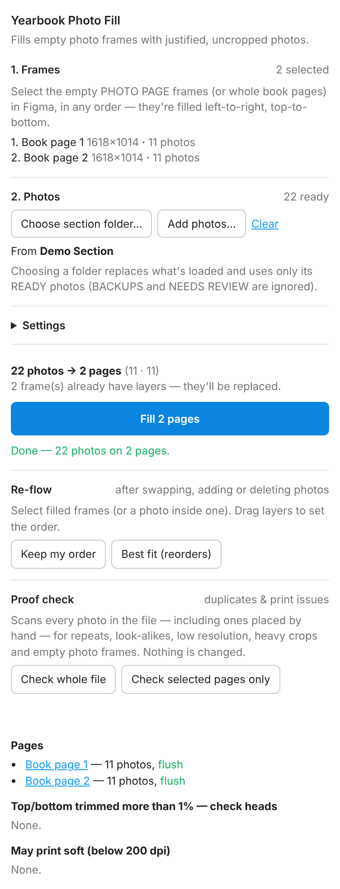
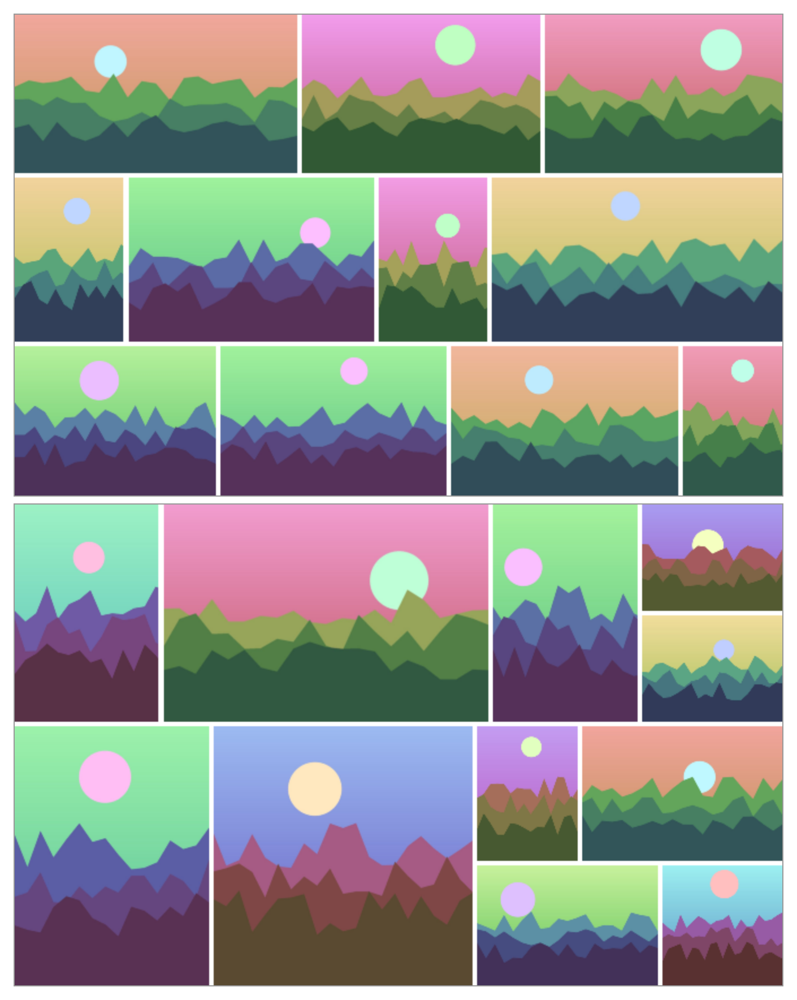
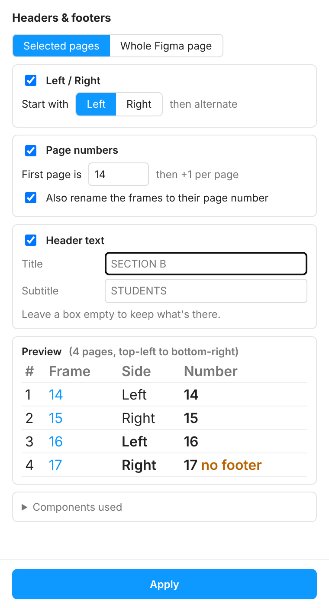
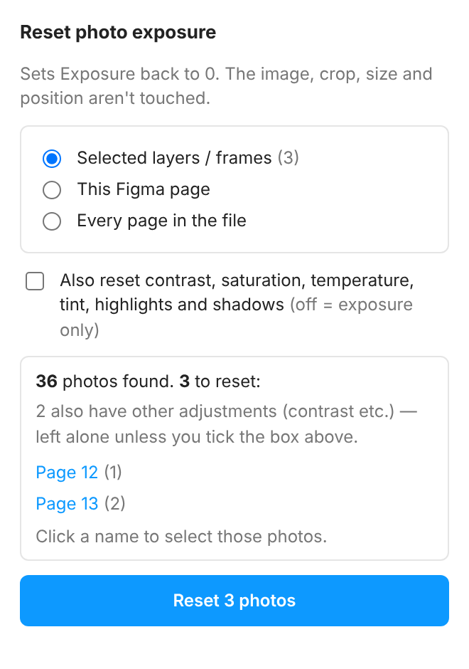

# Yearbook production plugins for Figma

Three Figma plugins I built to lay out a ~190-page printed class yearbook (325 copies) for a business-school graduating class, as part of **Rewind Lab**, a side project. Our three-person team uses them in the live production file.

The book draws on thousands of student-submitted photos across dozens of sections. Laying them out by hand, keeping duplicates out, and keeping headers, footers and page numbers right across 190 pages was slow and error-prone. Each plugin removes one of those jobs.

| Plugin | What it does |
|---|---|
| [**Photo Fill**](photo-fill/) | Fills page frames with justified photo layouts, catches duplicates across the whole file, and runs a pre-print proof check |
| [**Headers & Footers**](headers-footers/) | Batch-sets left/right page orientation, page numbers, frame names and section titles |
| [**Reset Exposure**](reset-exposure/) | Bulk-resets image adjustments without touching crop, size or position |

---

## Photo Fill

Pick a section's photo folder, select the page frames, click Fill. The engine places every photo in justified rows with equal gutters, keeps each photo's shape (trims are capped at a few percent so pages finish flush), and spreads portrait/landscape shapes evenly across pages.

<p>
  
  &nbsp;
  
</p>

*Placeholder images; the real book uses student photos.*

- **Layout engine** ([`src/layout.js`](photo-fill/src/layout.js)): plans how many photos each page gets, then searches row and stack arrangements per page, scoring crop, whitespace and balance. Pure JS, deterministic (seeded), no dependencies.
- **Duplicate safeguards:** the same file loaded twice is used once; before placing, it scans every page of the Figma file and offers to leave out photos that are already placed elsewhere.
- **Re-flow:** after swapping or deleting photos, re-lays out a page in layer order or best-fit order.
- **Proof check:** reads every image in the file, including ones placed by hand, and lists duplicates (even re-crops or re-uploads), look-alikes, empty frames, photos that will print below the dpi threshold, and over-cropped photos. Each one links to where it is.
- Handles iPhone HEIC files and EXIF rotation in the browser.

## Headers & Footers

Select a section's pages, choose whether the first page is Left or Right, type the first page number and the section title, and review the preview before applying.



- Finds the HEADER and FOOTER component instances on each page and orders pages by their position on the canvas.
- Alternates the Left/Right variant on both components, writes the page number into the footer and renames each frame to match.
- Rewrites header title and subtitle across a section in one go.
- Variant swaps can reset text overrides, so it captures each instance's text before the swap and restores it afterwards.
- One undo step for the whole run.

## Reset Exposure

Some photos had picked up a lowered Exposure adjustment. This resets exposure (and optionally contrast, saturation, temperature, tint, highlights and shadows) on every image in the selection, page or file. Each image fill is copied with only its adjustment values changed, so the image, crop transform, fill mode, size and position stay exactly as they were.



---

## Install (Figma desktop app)

1. Download or clone this repo.
2. In Figma: **Plugins → Development → Import plugin from manifest…**
3. Pick the `manifest.json` inside the plugin's folder (`photo-fill/`, `headers-footers/` or `reset-exposure/`).

## Tests

The Figma Plugin API only runs inside Figma, so the plugin logic is tested against a mocked API in Node:

```bash
npm test
```

- `headers-footers`: page ordering, Left/Right alternation, numbering, frame renaming, and text surviving variant swaps (the mock deliberately resets text on every swap).
- `reset-exposure`: only the exposure value changes; image, transform, scale mode, opacity and other fills are untouched.
- `photo-fill`: the layout engine places every photo exactly once, inside the page, with no overlaps.

The plugin UIs were also exercised end-to-end in a browser harness (Playwright) before being used on the real file.

## How I built these

I built these with Claude (Anthropic's AI assistant) as my coding partner. I defined each problem from our actual production bottlenecks, specified how each tool should behave, reviewed the previews and screenshots, and tested every change in our live yearbook file before the team relied on it. Claude wrote most of the code. Features were added as production needs came up. For example, Reset Exposure was built the day we found photos with a lowered exposure setting, and frame renaming was added to Headers & Footers mid-production.

## Structure

```
photo-fill/        manifest.json, code.js (plugin), ui.html (built UI)
  src/             layout.js (layout engine), ui.src.html (UI source)
  build.js         inlines layout.js into ui.html: node photo-fill/build.js
  test/
headers-footers/   manifest.json, code.js, ui.html, test/
reset-exposure/    manifest.json, code.js, ui.html, test/
docs/              screenshots
```

MIT licensed.
